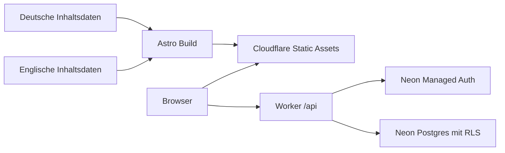

# Technischer Aufbau

Astro, TypeScript und CSS erzeugen statische Lernseiten. Ein TypeScript-Worker ergänzt freiwillige Accounts und synchronisierten Fortschritt. Der komplette Lerninhalt bleibt ohne Konto nutzbar.

## Dateien und Verantwortlichkeiten

| Bereich | Dateien |
| --- | --- |
| Inhalte und Übersetzungen | `src/data/content.ts`, `src/data/content.en.ts` |
| Seiten und Layout | `src/pages/`, `src/components/`, `src/layouts/` |
| Englische statische Routen | `src/pages/en/[...page].astro` |
| Sprache und Routen | `src/lib/locale.ts`, `src/lib/i18n.ts` |
| Suche, Filter, Quiz und Design | `src/scripts/{site,topics,paths,quiz,theme-init}.ts` |
| Account und Fortschritt | `src/scripts/account.ts`, `src/scripts/progress-client.ts` |
| API, Sessions und Datenzugriff | `worker/index.ts`, `src/lib/progress.ts` |
| Schema und eingeschränkte Rolle | `migrations/`, `scripts/{migrate,provision-runtime}.ts` |
| Konfiguration | `astro.config.ts`, `neon.ts`, `wrangler.jsonc`, `tsconfig.json` |

Deutsch liegt unter `/`, Englisch unter `/en/`. Beide verwenden dieselben Inhaltskennungen. Der Sprachschalter erhält Pfad, Suchparameter und Sprungmarke. Navigation, Inhalte, Suche, Quizantworten, Erklärungen und persönliche Seiten sind übersetzt. Quellen behalten ihre Originalsprache und Herausgeber.

Das Design folgt zunächst der Systemeinstellung. Eine bewusste Auswahl überschreibt diese und bleibt in `localStorage`. Ein früh im Head eingebundenes, beim Build aus TypeScript erzeugtes Skript setzt das Design vor dem Rendern. JavaScript-Quelldateien werden nicht von Hand gepflegt.

## Persönliche Daten

Die offizielle Neon-Auth-Proxyfunktion setzt gleichursprüngliche HttpOnly-Sessioncookies; Datenbankzugang und Cookie-Schlüssel bleiben Worker-Secrets. Jede Fortschrittsanfrage validiert die Session erneut beim Auth-Dienst. Der Server leitet die Nutzer-ID daraus ab, prüft bekannte Inhaltskennungen und berechnet richtige Quizantworten selbst.

Eine Transaktion setzt die authentifizierte ID als lokalen PostgreSQL-Kontext und liest oder aktualisiert nur deren Zeilen. Die Rolle `it_worlds_app` besitzt weder Owner- noch RLS-Bypass-Rechte und keinen Lesezugriff auf Auth-Tabellen. Row Level Security ist erzwungen. POST-Anfragen brauchen die eigene Origin und JSON; ihre Größe ist begrenzt. API-Antworten werden nicht gecacht. Authentifizierungsdaten und Datenbankfehler werden nicht protokolliert.

Gespeichert werden Inhaltskennung, Typ, bearbeitet/gelesen, jemals richtig beantwortet und letzter Änderungszeitpunkt. Geplante Lektionen sind nicht abhackbar. Ein Quiz-Neustart beginnt nur den aktuellen Durchlauf neu; den persönlichen Lernstand ändern die Checkboxen separat.

Ein Ausfall von Auth oder Datenbank beeinträchtigt persönliche Funktionen. Statische Seiten und Quiz bleiben verfügbar. Details: [Accounts](ACCOUNTS.md), [Cloudflare](CLOUDFLARE.md).

## Prüfen und erweitern

`npm test` prüft Inhalt, Quellenverknüpfungen, Sprachparität, Fortschrittsvalidierung und Account-Fehlermeldungen. `npm run check` prüft strikt sämtliche TypeScript- und Astro-Quellen einschließlich Worker und Skripten. `npm run build` erzeugt 40 HTML-Seiten. `npm run deploy:check` prüft das Worker-Paket ohne Veröffentlichung.

Mehrere Nutzer und RLS zusätzlich auf einem Entwicklungsbranch testen. Neue Migrationen werden mit Prüfsumme registriert und transaktional angewendet; bereits angewendete Migrationen bleiben unverändert.

Weitere Artikel, Lernspiele, ein CMS und isolierte Codeausführung sind spätere Erweiterungen. Angezeigte SQL-, Python- und PyTorch-Beispiele werden nicht im Browser ausgeführt. Das unabhängige Fachreview bleibt offen.
