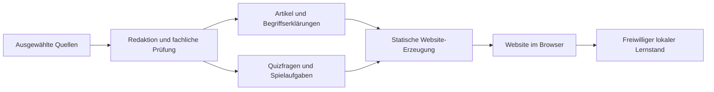

# Technische Ansätze

## Rahmen für die Entscheidung

IT-Worlds soll überwiegend redaktionelle Inhalte mit einzelnen interaktiven Übungen verbinden. Der erste Lernpfad braucht noch keine Nutzerkonten, keinen Server für Spielstände und keine eigene Datenbank. Inhalte sollen leicht korrigierbar, gut auffindbar und auf dem Smartphone lesbar sein.

Alle folgenden Optionen sind Planungsvorschläge. Es sind weder Abhängigkeiten installiert noch ein Framework, Hostinganbieter oder Dienst eingerichtet.

## Drei mögliche Wege

| Ansatz | Stärken für IT-Worlds | Abwägung |
| --- | --- | --- |
| Astro + Markdown/MDX + TypeScript | Artikel statisch erzeugen, interaktive Inseln gezielt ergänzen, wenige Laufzeitdienste | einzelne Spiele und Suche bewusst integrieren; spätere Konten brauchen zusätzliche Architektur |
| Next.js + React + TypeScript | umfangreiche Interaktionen, dynamische Bereiche und spätere Konten gut in einer Anwendung abbildbar | für den Start mehr Server-, Cache- und Betriebsentscheidungen als nötig |
| Docusaurus + MDX | Navigation und Suche für eine dokumentationsartige Wissensbasis gut vorbereitbar; React-Komponenten für Übungen | bei freier Gestaltung, Lernpfaden und Spielübersichten stärker vom Dokumentationsmodell ausgehend |

**Vorläufige Empfehlung:** Astro mit Markdown-Inhalten und gezielten interaktiven Komponenten. Das passt zum geplanten Schwerpunkt auf Erklärungen und Quellen und ermöglicht einen kleinen Einstieg. Wenn Konten, persönliche Lernpläne oder eine umfangreiche interaktive Anwendung von Anfang an erforderlich werden, sollte die Abwägung zugunsten einer Anwendungsarchitektur neu erfolgen. Bestehende Kenntnisse des Projektteams können wichtiger sein als kleine Framework-Vorteile.

## Inhalte und Interaktion trennen

Ein mögliches späteres Modell:

Artikel wären als Markdown mit Metadaten pflegbar. Quizdaten könnten ein strukturiertes Format erhalten, getrennt von der Auswertungslogik. Spiele würden dieselben Inhaltskennungen referenzieren. Der Build könnte fehlende Verweise, doppelte IDs und unvollständige Antworten erkennen.

MDX ist eine Option, wenn Artikel eingebettete Komponenten brauchen. Ausführbare Inhaltsdateien sollten dabei nur aus vertrauenswürdigen Beiträgen stammen. Ein späteres CMS kann dieselben Inhaltsmodelle nutzen, wenn Bearbeitung per Git für das Redaktionsteam zu umständlich wird.

## Suche, Fortschritt und spätere Datenhaltung

- **Suche:** Für statische Inhalte zunächst einen zur Build-Zeit erzeugten Suchindex erwägen, beispielsweise Pagefind. Themen- und Schwierigkeitsfilter ergänzen die Volltextsuche.
- **Lernstand:** Optional zuerst im Browser speichern, mit Rücksetzfunktion und Hinweis auf Gerätebindung. Ein Neustart der Übung muss auch ohne Speicherung funktionieren.
- **Konten:** Erst planen, wenn geräteübergreifender Fortschritt oder persönliche Lernpläne gebraucht werden. Dann gehören Anmeldung, Löschung, Berechtigungen und die Übernahme vorhandener lokaler Daten zusammen.
- **CMS:** Nach redaktionellem Bedarf auswählen. Ein separater Dienst erhöht Betriebsaufwand und Zugriffsverwaltung; Git-basierte Inhalte reichen möglicherweise lange aus.

Eine Datenbank wird sinnvoll, wenn persistente persönliche Daten oder redaktionelle Abläufe sie tatsächlich benötigen. Dann sind unter anderem Nutzer, Inhaltsversionen, Übungsversuche und Fortschritt zu modellieren. Eine konkrete Datenbank oder ein Anbieter ist noch nicht ausgewählt.

## Hosting und Betrieb als spätere Entscheidung

Eine statisch erzeugte Website könnte beispielsweise auf GitHub Pages oder Cloudflare Pages liegen. Vorschauen pro Pull Request wären für Inhaltsprüfung hilfreich. Für dynamische Serverfunktionen muss später ein kompatibler Ausführungsort gewählt werden. Kosten, Limits, Datenschutzanforderungen und Framework-Unterstützung werden vor einer Festlegung geprüft; hier wird noch keine Plattform eingerichtet.

Später sinnvolle automatisierte Prüfungen:

- Inhaltsmetadaten und interne Links validieren.
- Bei Anwendungscode Typprüfung und Build ausführen.
- Quiz-Auswertung und Fortschrittslogik gezielt prüfen.
- Einen vollständigen Lernweg auf Mobilansichten und mit Tastatur durchgehen.

Für dieses reine Konzeptpaket reichen Dokumentations- und Vorlagenprüfungen; ein Anwendungstestlauf existiert noch nicht.

## Grenzen für aktive Übungen

Ein Reihenfolge-Spiel benötigt keine Ausführung fremden Codes. Eine spätere SQL-Werkstatt oder Programmierumgebung braucht dagegen ein eigenes Isolationskonzept mit vorbereiteten Daten und begrenzten Ressourcen. Solche Übungen dürfen keinen Zugriff auf produktive Daten oder die Infrastruktur des Projekts erhalten.

## Fragen vor einer Architekturentscheidung

1. Bleiben Artikel und kleine Übungen der Schwerpunkt oder wird eine umfangreiche Lernanwendung benötigt?
2. Wer bearbeitet Inhalte, und ist ein Git-Workflow praktikabel?
3. Muss Lernfortschritt überhaupt gespeichert und synchronisiert werden?
4. Welche Kenntnisse, Betriebsmöglichkeiten und welches Budget stehen zur Verfügung?
5. Welcher Ansatz ermöglicht einen kleinen, verständlichen ersten Lernpfad mit geringem Pflegeaufwand?
